<div align="center">

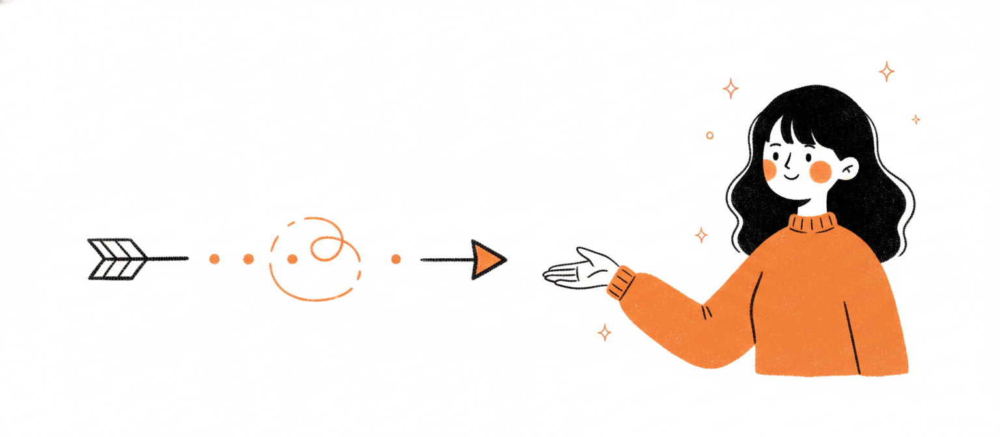

# Power Design

<div align="center">
  
  <p><strong>Arckhé AI</strong></p>
</div>


### Uma skill do Claude para slides que nêƒÂ£o parecem feitos por IA.

**Brand DNA êƒâ€” 20 princêƒÂ­pios de design codificados ê¢â€ â€™ decks HTML bonitos, sob demanda.**

[**Ver os princêƒÂ­pios ê¢â€ â€™**](https://inematds.github.io/power-design/) ê‚·
[**Comunidade ê¢â€ â€™**](https://inema.club)

</div>

---

## O que faz

Power Design êƒÂ© uma skill do Claude Code que combina duas coisas que outros geradores de deck de IA ignoram:

1. **Brand DNA** ê¢â‚¬â€ extraêƒÂ­do ao vivo de qualquer URL via Firecrawl, ou escolhido entre **72+ sistemas de marca prêƒÂ©-prontos** (Stripe, Apple, Linear, Spotify, Vercel, Notion, Tesla, Airbnbê¢â‚¬Â¦)
2. **20 princêƒÂ­pios de design codificados** ê¢â‚¬â€ tirados de Tufte, Reynolds, Duarte, Williams, Refactoring UI, MêƒÂ¼ller-Brockmann, Mayer, WCAG 2.2

O resultado: cada deck êƒÂ© ao mesmo tempo consistente com a marca e objetivamente bem projetado. Sem gradientes roxos. Sem slides herêƒÂ³i com seis bullets. Sem sombras em barras.

---

## As 20 regras, ilustradas

Cada slide passa pelos mesmos 20 critêƒÂ©rios. **[Leia o manual completo ê¢â€ â€™](https://inematds.github.io/power-design/)**

<div align="center">

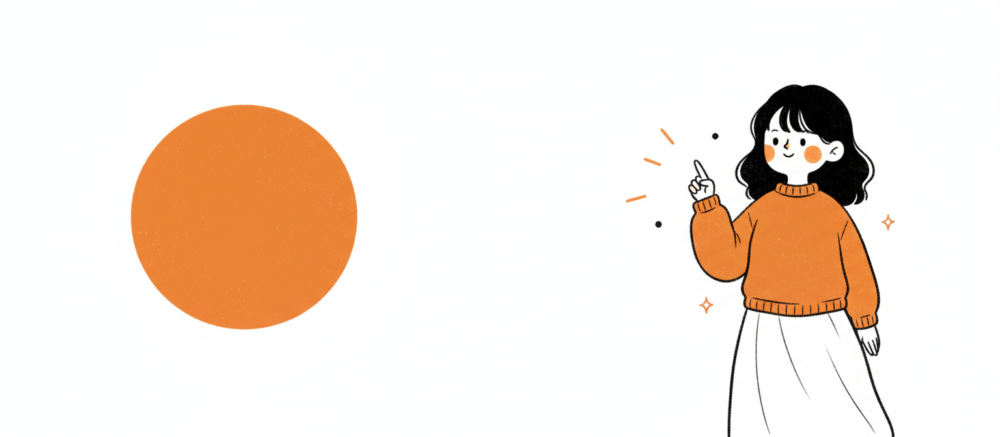   
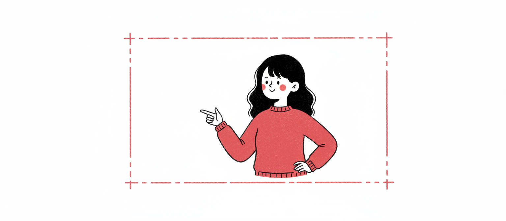 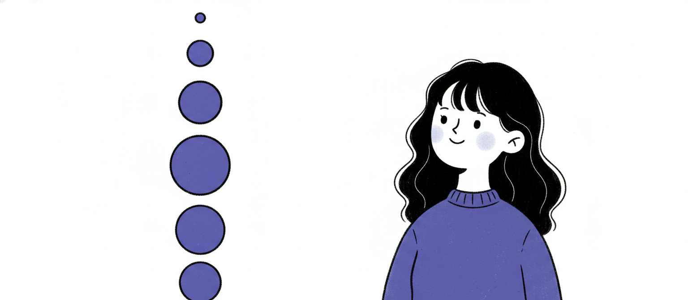  
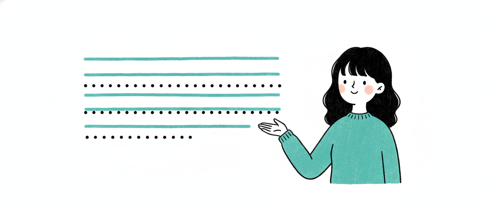 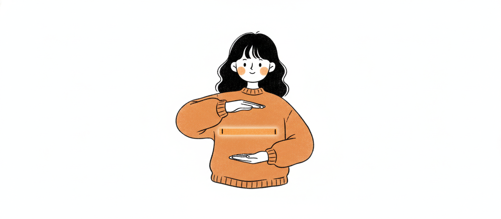 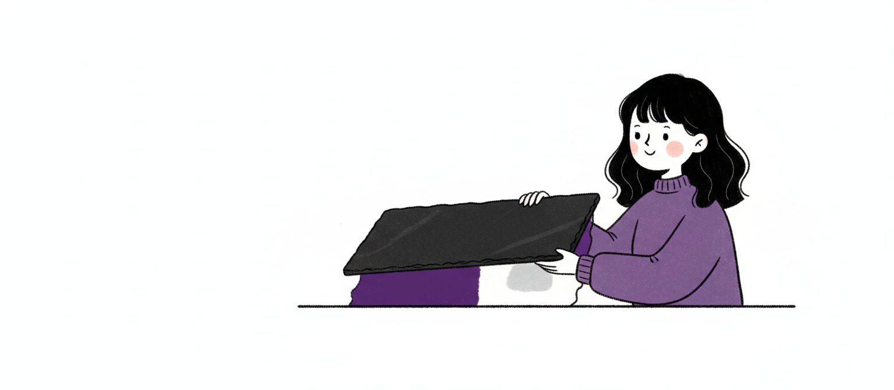 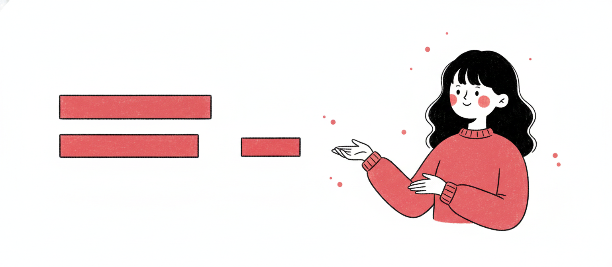
  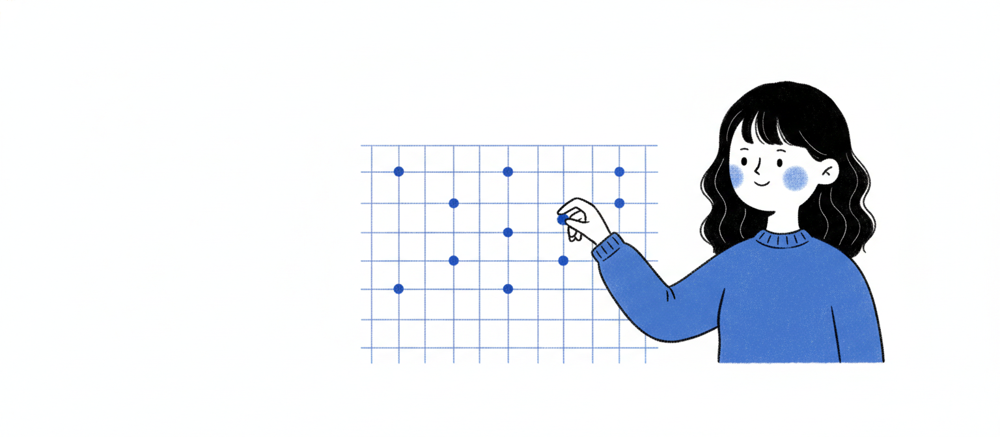 
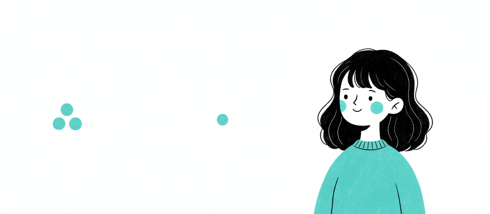 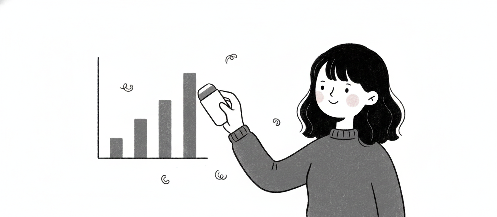  

</div>

| # | Regra | Fonte |
|---:|---|---|
|  1 | Uma ideia por slide | Reynolds; Duarte |
|  2 | LegêƒÂ­vel em ê¢â€°Â¤3 segundos | Duarte; NN/g |
|  3 | ê¢â€°Â¤7ꂱ2 blocos visuais; ideal 3ê¢â‚¬â€œ5 | Miller 1956; Cowan 2001 |
|  4 | ProporêƒÂ§êƒÂ£o de espaêƒÂ§o em branco ê¢â€°Â¥40% | Refactoring UI; Reynolds |
|  5 | Zona de seguranêƒÂ§a de 5% em todas as bordas | Broadcast title-safe |
|  6 | Tipografia em escala modular (1.25ê¢â‚¬â€œ1.618) | Tschichold; Bringhurst |
|  7 | MêƒÂ¡ximo 4 tamanhos de tipo por slide | Refactoring UI |
|  8 | Corpo ê¢â€°Â¥24px, têƒÂ­tulo ê¢â€°Â¥48px | Reynolds; Duarte |
|  9 | Entrelinhas 1.4ê¢â‚¬â€œ1.6 corpo, 1.05ê¢â‚¬â€œ1.2 display | Butterick; Bringhurst |
| 10 | Comprimento de linha ê¢â€°Â¤60 caracteres | Bringhurst |
| 11 | Contraste WCAG ê¢â€°Â¥4.5:1 corpo, ideal 7:1 (AAA) | WCAG 2.2 |
| 12 | DistribuiêƒÂ§êƒÂ£o de cor 60-30-10 | Itten; Refactoring UI |
| 13 | Um destaque por slide | Tufte |
| 14 | Nunca codificar significado apenas por cor | WCAG 1.4.1 |
| 15 | Grade de 8pt para todos os espaêƒÂ§amentos | Bryn Jackson; Material |
| 16 | Tudo alinhado a uma grade | MêƒÂ¼ller-Brockmann |
| 17 | Proximidade: relacionados ê¢â€°Â¤16px, distintos ê¢â€°Â¥48px | Gestalt; Williams |
| 18 | Taxa de tinta de dados ê¢â€°Â¥80% | Tufte 1983 |
| 19 | PadrêƒÂ£o F: têƒÂ­tulo + visual principal no topo esquerdo | NN/g eye-tracking |
| 20 | Dois modos vêƒÂ¡lidos ê¢â‚¬â€ escolha um e mantenha | Tufte vs Reynolds |

---

## InstalaêƒÂ§êƒÂ£o

```bash
git clone https://github.com/inematds/power-design ~/.claude/skills/power-design
```

Depois no Claude Code:

```
> use power-design ê¢â‚¬â€ crie um deck para stripe.com sobre o nosso novo lanêƒÂ§amento
```

A skill vai:
1. Perguntar pela marca (cole uma URL, escolha da biblioteca, ou pule para o padrêƒÂ£o)
2. Extrair o Brand DNA via Firecrawl (~30 segundos)
3. Pedir um briefing de conteêƒÂºdo (têƒÂ­tulo + 3ê¢â‚¬â€œ5 pontos)
4. Gerar `slides.html` aplicando Brand DNA êƒâ€” 20 regras
5. Abrir no browser. Refinar via conversa natural.

---

## Biblioteca de marcas ê¢â‚¬â€ 72+ sistemas prêƒÂ©-prontos

| Tech / IA | FinanêƒÂ§as | Auto / Lifestyle | MêƒÂ­dia | Produtividade |
|---|---|---|---|---|
| Anthropic / Claude ê‚· OpenAI ê‚· DeepSeek ê‚· Linear ê‚· Vercel ê‚· Stripe ê‚· Cursor ê‚· GitHub ê‚· Figma ê‚· Webflow ê‚· Framer ê‚· Mintlify ê‚· Notion ê‚· Raycast ê‚· Lovable ê‚· Resend ê‚· Sentry ê‚· Supabase ê‚· Superhuman ê‚· MongoDB ê‚· Sanity ê‚· Posthog ê‚· Replicate ê‚· Runway ê‚· Hashicorp ê‚· ElevenLabs ê‚· Cal ê‚· Clay ê‚· Composio ê‚· ClickHouse ê‚· Cohere ê‚· Mistral ê‚· Together ê‚· x.ai ê‚· Ollama ê‚· OpenCode ê‚· Expo ê‚· Pinterest ê‚· Glaido | Stripe ê‚· Mastercard ê‚· Coinbase ê‚· Binance ê‚· Kraken ê‚· Revolut ê‚· Wise ê‚· Shopify | Tesla ê‚· BMW ê‚· BMW M ê‚· Bugatti ê‚· Ferrari ê‚· Lamborghini ê‚· Renault ê‚· Nike ê‚· Airbnb ê‚· Apple ê‚· Starbucks ê‚· Grind ê‚· Vodafone | The Verge ê‚· Wired ê‚· Spotify ê‚· YouTube ê‚· Sony ê‚· PlayStation ê‚· IBM | Notion ê‚· Slack ê‚· Miro ê‚· Intercom ê‚· Zapier ê‚· Uber ê‚· NVIDIA ê‚· SpaceX ê‚· VoltAgent ê‚· Warp |

Cada entrada êƒÂ© um êƒÂºnico arquivo `brand-style.md`: cores, tipografia, voz, componentes, URL de origem. Adicione a sua usando `brands/_template.md`.

---

## Como a skill funciona (por dentro)

```
   ê¢â€Å’ê¢â€â‚¬ê¢â€â‚¬ê¢â€â‚¬ê¢â€â‚¬ê¢â€â‚¬ê¢â€â‚¬ê¢â€â‚¬ê¢â€â‚¬ê¢â€â‚¬ê¢â€â‚¬ê¢â€â‚¬ê¢â€â‚¬ê¢â€â‚¬ê¢â€â‚¬ê¢â€â‚¬ê¢â€â‚¬ê¢â€â‚¬ê¢â€â‚¬ê¢â€â‚¬ê¢â€â‚¬ê¢â€â‚¬ê¢â€â‚¬ê¢â€â‚¬ê¢â€â‚¬ê¢â€â‚¬ê¢â€â‚¬ê¢â€â‚¬ê¢â€â‚¬ê¢â€â‚¬ê¢â€â‚¬ê¢â€â‚¬ê¢â€â‚¬ê¢â€â‚¬ê¢â€â‚¬ê¢â€â‚¬ê¢â€â‚¬ê¢â€â‚¬ê¢â€â‚¬ê¢â€â‚¬ê¢â€â‚¬ê¢â€â‚¬ê¢â€Â
   ê¢â€â€š  1. Brand DNA       (URL ê¢â€ â€™ Firecrawl)   ê¢â€â€š
   ê¢â€â€š     OU escolha de  brands/<nome>.md     ê¢â€â€š
   ê¢â€Å“ê¢â€â‚¬ê¢â€â‚¬ê¢â€â‚¬ê¢â€â‚¬ê¢â€â‚¬ê¢â€â‚¬ê¢â€â‚¬ê¢â€â‚¬ê¢â€â‚¬ê¢â€â‚¬ê¢â€â‚¬ê¢â€â‚¬ê¢â€â‚¬ê¢â€â‚¬ê¢â€â‚¬ê¢â€â‚¬ê¢â€â‚¬ê¢â€â‚¬ê¢â€â‚¬ê¢â€â‚¬ê¢â€â‚¬ê¢â€â‚¬ê¢â€â‚¬ê¢â€â‚¬ê¢â€â‚¬ê¢â€â‚¬ê¢â€â‚¬ê¢â€â‚¬ê¢â€â‚¬ê¢â€â‚¬ê¢â€â‚¬ê¢â€â‚¬ê¢â€â‚¬ê¢â€â‚¬ê¢â€â‚¬ê¢â€â‚¬ê¢â€â‚¬ê¢â€â‚¬ê¢â€â‚¬ê¢â€â‚¬ê¢â€â‚¬ê¢â€Â¤
   ê¢â€â€š  2. Regras de design  principles/...md  ê¢â€â€š
   ê¢â€Å“ê¢â€â‚¬ê¢â€â‚¬ê¢â€â‚¬ê¢â€â‚¬ê¢â€â‚¬ê¢â€â‚¬ê¢â€â‚¬ê¢â€â‚¬ê¢â€â‚¬ê¢â€â‚¬ê¢â€â‚¬ê¢â€â‚¬ê¢â€â‚¬ê¢â€â‚¬ê¢â€â‚¬ê¢â€â‚¬ê¢â€â‚¬ê¢â€â‚¬ê¢â€â‚¬ê¢â€â‚¬ê¢â€â‚¬ê¢â€â‚¬ê¢â€â‚¬ê¢â€â‚¬ê¢â€â‚¬ê¢â€â‚¬ê¢â€â‚¬ê¢â€â‚¬ê¢â€â‚¬ê¢â€â‚¬ê¢â€â‚¬ê¢â€â‚¬ê¢â€â‚¬ê¢â€â‚¬ê¢â€â‚¬ê¢â€â‚¬ê¢â€â‚¬ê¢â€â‚¬ê¢â€â‚¬ê¢â€â‚¬ê¢â€â‚¬ê¢â€Â¤
   ê¢â€â€š  3. ComposiêƒÂ§êƒÂ£o   brand êƒâ€” regras ê¢â€ â€™ HTML  ê¢â€â€š
   ê¢â€â€ê¢â€â‚¬ê¢â€â‚¬ê¢â€â‚¬ê¢â€â‚¬ê¢â€â‚¬ê¢â€â‚¬ê¢â€â‚¬ê¢â€â‚¬ê¢â€â‚¬ê¢â€â‚¬ê¢â€â‚¬ê¢â€â‚¬ê¢â€â‚¬ê¢â€â‚¬ê¢â€â‚¬ê¢â€â‚¬ê¢â€â‚¬ê¢â€â‚¬ê¢â€â‚¬ê¢â€â‚¬ê¢â€â‚¬ê¢â€â‚¬ê¢â€â‚¬ê¢â€â‚¬ê¢â€â‚¬ê¢â€â‚¬ê¢â€â‚¬ê¢â€â‚¬ê¢â€â‚¬ê¢â€â‚¬ê¢â€â‚¬ê¢â€â‚¬ê¢â€â‚¬ê¢â€â‚¬ê¢â€â‚¬ê¢â€â‚¬ê¢â€â‚¬ê¢â€â‚¬ê¢â€â‚¬ê¢â€â‚¬ê¢â€â‚¬ê¢â€Ëœ
                      ê¢â€ â€œ
                  slides.html
```

O runbook da skill estêƒÂ¡ em `SKILL.md`. Os 20 princêƒÂ­pios de design (com citaêƒÂ§êƒÂµes de pesquisa e limites numêƒÂ©ricos) estêƒÂ£o em `principles/design-principles.md`.

---

## CrêƒÂ©ditos

- **Biblioteca de marcas** ê¢â‚¬â€ derivada e reestruturada de [VoltAgent/awesome-design-md](https://github.com/VoltAgent/awesome-design-md), com permissêƒÂ£o e crêƒÂ©dito.
- **Pesquisa de design** ê¢â‚¬â€ Edward Tufte, Garr Reynolds, Nancy Duarte, Robin Williams (CRAP), Adam Wathan & Steve Schoger (Refactoring UI), Josef MêƒÂ¼ller-Brockmann, Matthew Butterick, Robert Bringhurst, Richard Mayer, Nielsen Norman Group, WCAG 2.2.
- **IlustraêƒÂ§êƒÂµes** ê¢â‚¬â€ geradas via Kie.ai nano-banana 2.

---

## LicenêƒÂ§a

MIT ê¢â‚¬â€ veja [LICENSE](LICENSE).

---

<div align="center">

[**PrincêƒÂ­pios ê¢â€ â€™**](https://inematds.github.io/power-design/) ê‚·
[**Comunidade ê¢â€ â€™**](https://inema.club)

</div>

---

<div align="center">
  
  <p><strong>Arckhé AI</strong></p>
</div>