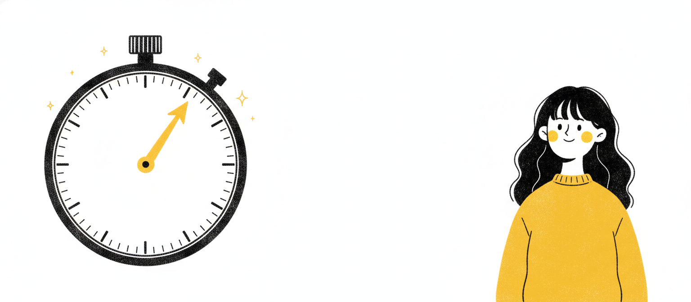
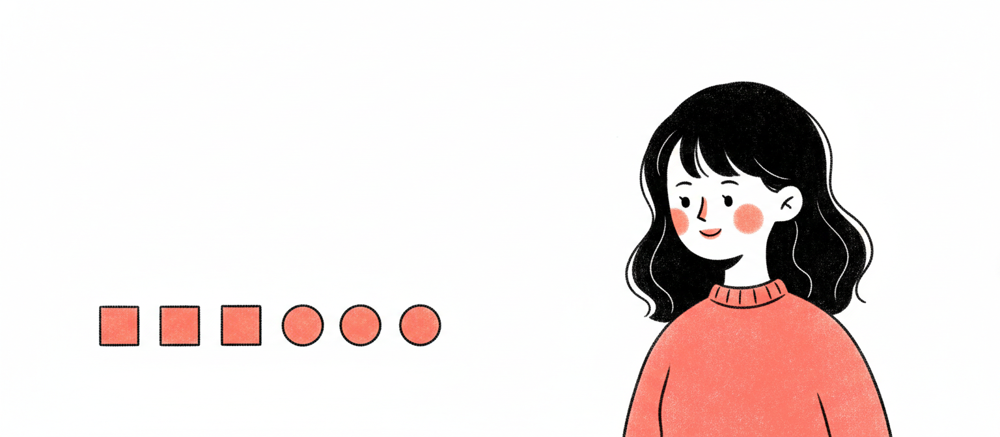
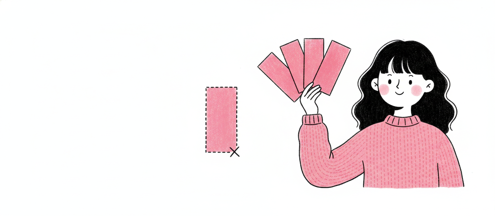
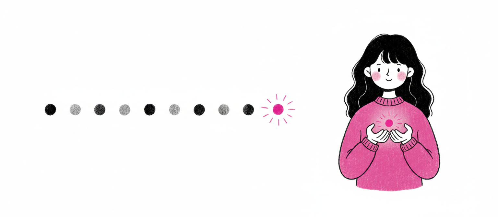
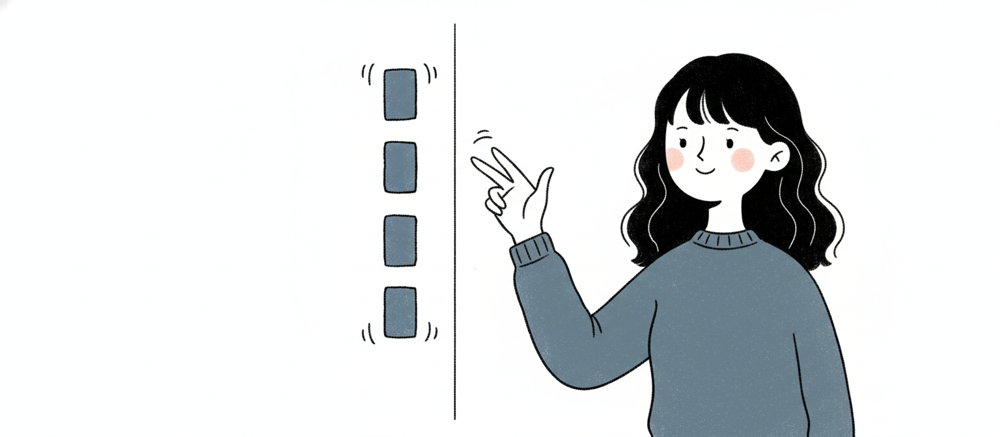
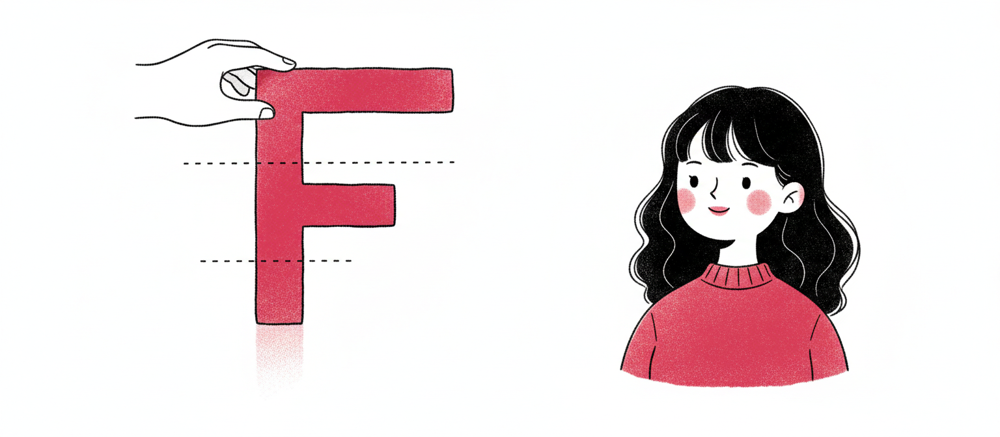

<div align="center">


# Power Design

<div align="center">
  
  <p><strong>Arckhé AI</strong></p>
</div>


### Uma skill do Claude para slides que não parecem feitos por IA.

**Brand DNA × 20 princípios de design codificados → decks HTML bonitos, sob demanda.**

[**Ver os princípios →**](https://inematds.github.io/power-design/) ·
[**Comunidade →**](https://inema.club)

</div>

---

## O que faz

Power Design é uma skill do Claude Code que combina duas coisas que outros geradores de deck de IA ignoram:

1. **Brand DNA** — extraído ao vivo de qualquer URL via Firecrawl, ou escolhido entre **72+ sistemas de marca pré-prontos** (Stripe, Apple, Linear, Spotify, Vercel, Notion, Tesla, Airbnb…)
2. **20 princípios de design codificados** — tirados de Tufte, Reynolds, Duarte, Williams, Refactoring UI, Müller-Brockmann, Mayer, WCAG 2.2

O resultado: cada deck é ao mesmo tempo consistente com a marca e objetivamente bem projetado. Sem gradientes roxos. Sem slides herói com seis bullets. Sem sombras em barras.

---

## As 20 regras, ilustradas

Cada slide passa pelos mesmos 20 critérios. **[Leia o manual completo →](https://inematds.github.io/power-design/)**

<div align="center">

   
   
   
   
   

</div>

| # | Regra | Fonte |
|---:|---|---|
|  1 | Uma ideia por slide | Reynolds; Duarte |
|  2 | Legível em ≤3 segundos | Duarte; NN/g |
|  3 | ≤7±2 blocos visuais; ideal 3–5 | Miller 1956; Cowan 2001 |
|  4 | Proporção de espaço em branco ≥40% | Refactoring UI; Reynolds |
|  5 | Zona de segurança de 5% em todas as bordas | Broadcast title-safe |
|  6 | Tipografia em escala modular (1.25–1.618) | Tschichold; Bringhurst |
|  7 | Máximo 4 tamanhos de tipo por slide | Refactoring UI |
|  8 | Corpo ≥24px, título ≥48px | Reynolds; Duarte |
|  9 | Entrelinhas 1.4–1.6 corpo, 1.05–1.2 display | Butterick; Bringhurst |
| 10 | Comprimento de linha ≤60 caracteres | Bringhurst |
| 11 | Contraste WCAG ≥4.5:1 corpo, ideal 7:1 (AAA) | WCAG 2.2 |
| 12 | Distribuição de cor 60-30-10 | Itten; Refactoring UI |
| 13 | Um destaque por slide | Tufte |
| 14 | Nunca codificar significado apenas por cor | WCAG 1.4.1 |
| 15 | Grade de 8pt para todos os espaçamentos | Bryn Jackson; Material |
| 16 | Tudo alinhado a uma grade | Müller-Brockmann |
| 17 | Proximidade: relacionados ≤16px, distintos ≥48px | Gestalt; Williams |
| 18 | Taxa de tinta de dados ≥80% | Tufte 1983 |
| 19 | Padrão F: título + visual principal no topo esquerdo | NN/g eye-tracking |
| 20 | Dois modos válidos — escolha um e mantenha | Tufte vs Reynolds |

---

## Instalação

```bash
git clone https://github.com/inematds/power-design ~/.claude/skills/power-design
```

Depois no Claude Code:

```
> use power-design — crie um deck para stripe.com sobre o nosso novo lançamento
```

A skill vai:
1. Perguntar pela marca (cole uma URL, escolha da biblioteca, ou pule para o padrão)
2. Extrair o Brand DNA via Firecrawl (~30 segundos)
3. Pedir um briefing de conteúdo (título + 3–5 pontos)
4. Gerar `slides.html` aplicando Brand DNA × 20 regras
5. Abrir no browser. Refinar via conversa natural.

---

## Biblioteca de marcas — 72+ sistemas pré-prontos

| Tech / IA | Finanças | Auto / Lifestyle | Mídia | Produtividade |
|---|---|---|---|---|
| Anthropic / Claude · OpenAI · DeepSeek · Linear · Vercel · Stripe · Cursor · GitHub · Figma · Webflow · Framer · Mintlify · Notion · Raycast · Lovable · Resend · Sentry · Supabase · Superhuman · MongoDB · Sanity · Posthog · Replicate · Runway · Hashicorp · ElevenLabs · Cal · Clay · Composio · ClickHouse · Cohere · Mistral · Together · x.ai · Ollama · OpenCode · Expo · Pinterest · Glaido | Stripe · Mastercard · Coinbase · Binance · Kraken · Revolut · Wise · Shopify | Tesla · BMW · BMW M · Bugatti · Ferrari · Lamborghini · Renault · Nike · Airbnb · Apple · Starbucks · Grind · Vodafone | The Verge · Wired · Spotify · YouTube · Sony · PlayStation · IBM | Notion · Slack · Miro · Intercom · Zapier · Uber · NVIDIA · SpaceX · VoltAgent · Warp |

Cada entrada é um único arquivo `brand-style.md`: cores, tipografia, voz, componentes, URL de origem. Adicione a sua usando `brands/_template.md`.

---

## Como a skill funciona (por dentro)

```
   ┌─────────────────────────────────────────┐
   │  1. Brand DNA       (URL → Firecrawl)   │
   │     OU escolha de  brands/<nome>.md     │
   ├─────────────────────────────────────────┤
   │  2. Regras de design  principles/...md  │
   ├─────────────────────────────────────────┤
   │  3. Composição   brand × regras → HTML  │
   └─────────────────────────────────────────┘
                      ↓
                  slides.html
```

O runbook da skill está em `SKILL.md`. Os 20 princípios de design (com citações de pesquisa e limites numéricos) estão em `principles/design-principles.md`.

---

## Créditos

- **Biblioteca de marcas** — derivada e reestruturada de [VoltAgent/awesome-design-md](https://github.com/VoltAgent/awesome-design-md), com permissão e crédito.
- **Pesquisa de design** — Edward Tufte, Garr Reynolds, Nancy Duarte, Robin Williams (CRAP), Adam Wathan & Steve Schoger (Refactoring UI), Josef Müller-Brockmann, Matthew Butterick, Robert Bringhurst, Richard Mayer, Nielsen Norman Group, WCAG 2.2.
- **Ilustrações** — geradas via Kie.ai nano-banana 2.

---

## Licença

MIT — veja [LICENSE](LICENSE).

---

<div align="center">

[**Princípios →**](https://inematds.github.io/power-design/) ·
[**Comunidade →**](https://inema.club)

</div>

---

<div align="center">
  
  <p><strong>Arckhé AI</strong></p>
</div>